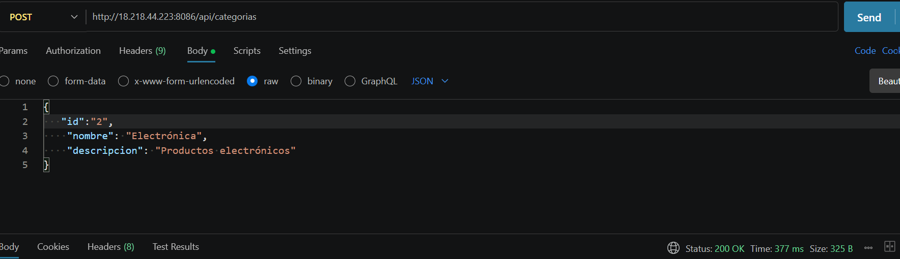
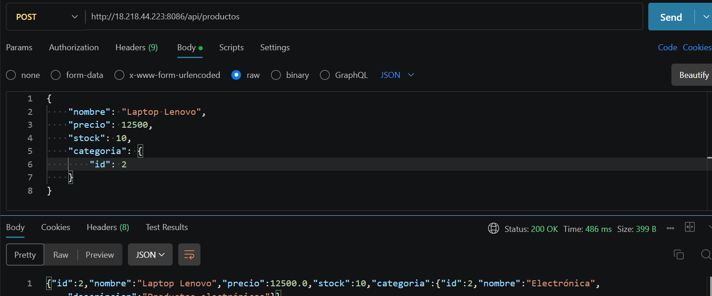
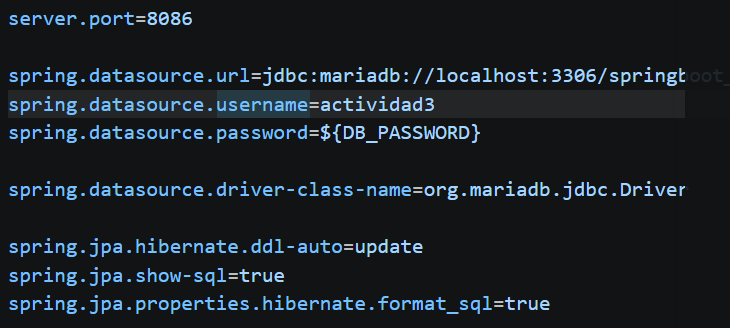
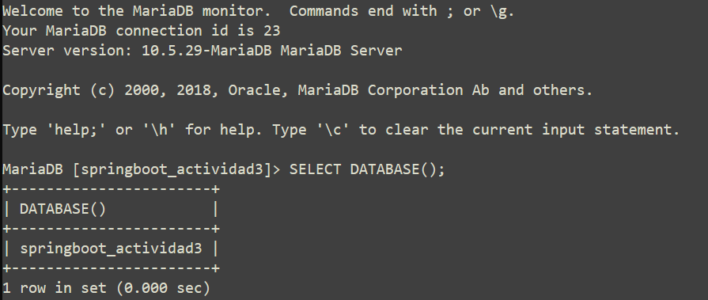
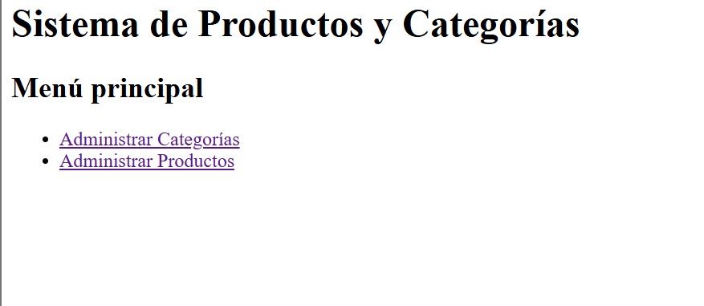
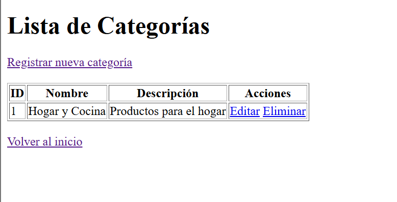
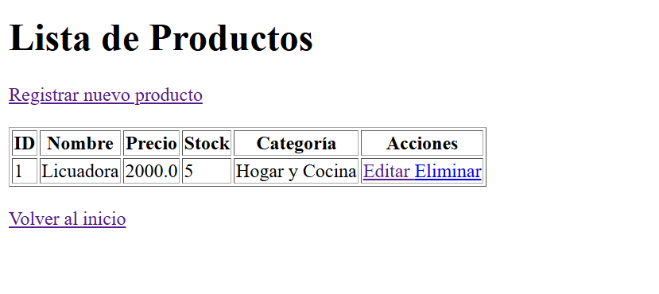

# Actividad 3 – CRUD con Spring Boot

## Sistema de Productos y Categorías

Este proyecto consiste en el desarrollo de una aplicación web utilizando Spring Boot, que permite administrar productos y categorías mediante operaciones CRUD (Crear, Leer, Actualizar y Eliminar).

La aplicación utiliza una base de datos relacional y cuenta con vistas web para administrar la información, además de una API REST que permite realizar operaciones desde herramientas como Postman.

## Tecnologías utilizadas

- Java 23
- Spring Boot 3.3.5
- Spring Data JPA
- Hibernate
- MySQL / MariaDB
- Thymeleaf
- Maven
- HTML
- Postman
- Git y GitHub

## Estructura del proyecto

El proyecto está organizado en diferentes paquetes para separar las responsabilidades:

```text
src/main/java/com/karlmt/spring/app3/
│
├── controllers/
│   ├── CategoriaController.java
│   ├── ProductoController.java
│   ├── InicioController.java
│   ├── CategoriaVistaController.java
│   └── ProductoVistaController.java
│
├── models/
│   ├── Categoria.java
│   └── Producto.java
│
├── repositories/
│   ├── CategoriaRepository.java
│   └── ProductoRepository.java
│
├── services/
│   ├── CategoriaService.java
│   └── ProductoService.java
│
└── SpringbootActividad3Application.java
```

Las vistas HTML se encuentran en:

```text
src/main/resources/templates/
│
├── index.html
├── categorias/
│   ├── listar.html
│   └── formulario.html
│
└── productos/
    ├── listar.html
    └── formulario.html
```

## Entidades y relación

El sistema cuenta con dos entidades principales:

**Categoría:**
- id
- nombre
- descripcion

**Producto:**
- id
- nombre
- precio
- stock
- categoria_id

Se implementó una relación de uno a muchos (One to Many), ya que una categoría puede contener varios productos, pero cada producto pertenece a una sola categoría.

Para representar esta relación se utilizaron las anotaciones:

- `@OneToMany`
- `@ManyToOne`
- `@JoinColumn`

## Funcionalidades

### Categorías
- Registrar categorías.
- Consultar todas las categorías.
- Consultar una categoría por su ID.
- Actualizar categorías.
- Eliminar categorías.

### Productos
- Registrar productos.
- Consultar todos los productos.
- Consultar un producto por su ID.
- Actualizar productos.
- Eliminar productos.
- Asociar cada producto con una categoría existente.

## Endpoints de la API REST

La aplicación cuenta con los siguientes endpoints:

### Categorías

| Método HTTP | Endpoint | Descripción |
|---|---|---|
| GET | `/api/categorias` | Consultar todas las categorías |
| GET | `/api/categorias/{id}` | Consultar categoría por ID |
| POST | `/api/categorias` | Registrar una categoría |
| PUT | `/api/categorias/{id}` | Actualizar una categoría |
| DELETE | `/api/categorias/{id}` | Eliminar una categoría |

### Productos

| Método HTTP | Endpoint | Descripción |
|---|---|---|
| GET | `/api/productos` | Consultar todos los productos |
| GET | `/api/productos/{id}` | Consultar producto por ID |
| POST | `/api/productos` | Registrar un producto |
| PUT | `/api/productos/{id}` | Actualizar un producto |
| DELETE | `/api/productos/{id}` | Eliminar un producto |

## Ejemplos de peticiones en Postman

### Registrar una categoría

Método: `POST`

```http
/api/categorias
```

Body → raw → JSON:

```json
{
    "nombre": "Electrónica",
    "descripcion": "Productos electrónicos"
}
```


### Registrar un producto

Método: `POST`

```http
/api/productos
```

Body → raw → JSON:

```json
{
    "nombre": "Laptop Lenovo",
    "precio": 12500,
    "stock": 10,
    "categoria": {
        "id": 2
    }
}
```

El producto se registra relacionado con la categoría cuyo ID se proporciona.

## Ejecución local

1. Clonar el repositorio:

```bash
git clone https://github.com/Karl335-lm/MBKact3_t4.git
```

2. Entrar a la carpeta:

```bash
cd MBKact3_t4
```

3. Crear la base de datos en MySQL:

```sql
CREATE DATABASE springboot_actividad3;
```

4. Configurar la variable de entorno `DB_PASSWORD` con la contraseña del usuario de MySQL o de MariaDB.

En Git Bash:

```bash
export DB_PASSWORD='TU_CONTRASEÑA'
```


5. Ejecutar el proyecto:

```bash
./mvnw spring-boot:run
```

La aplicación estará disponible en:

```text
http://localhost:8085/
```

## Despliegue en VPS

La aplicación también fue desplegada en un servidor VPS utilizando MariaDB.

- Puerto de ejecución: `8086`
- Base de datos: `springboot_actividad3`
- Perfil de Spring Boot: `vps`



URL de la aplicación:

http://18.218.44.223:8086/



API de categorías:

http://18.218.44.223:8086/categorias



API de productos:

http://18.218.44.223:8086/productos



## Autor

**Karla Martínez Bautista**

Proyecto desarrollado como parte de la Actividad 3 de Spring Boot.